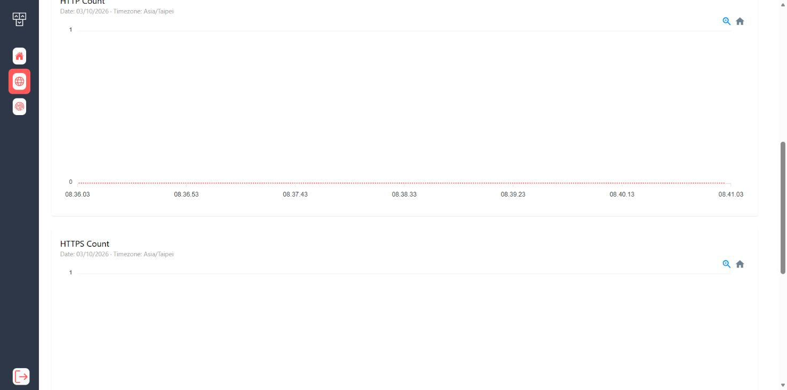
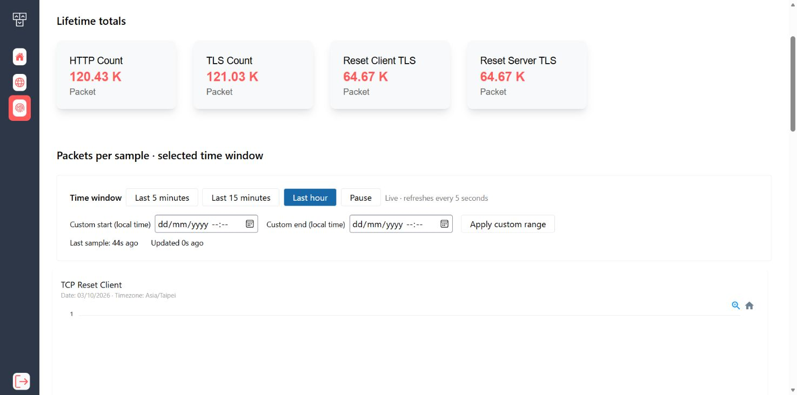
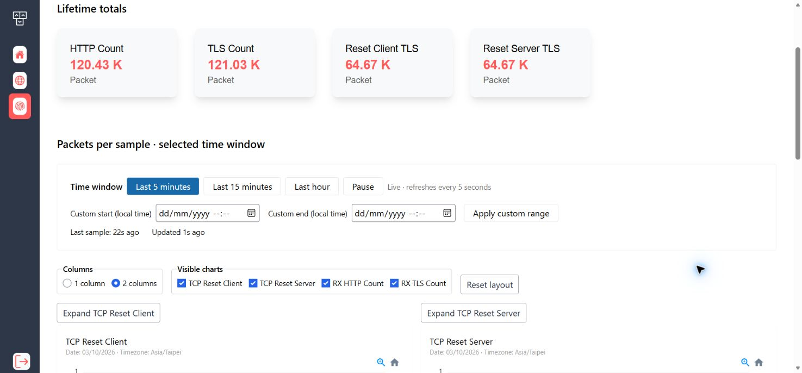

# NetPro project checkpoint — 3 October 2026

## Current lab state

The lab is operating on the `192.168.31.0/24` management/NAT network. The core services retain their separate `192.168.0.90`–`.95` control addresses. Test Gateway and Client links are `192.168.80.28/24` and `.29/24` on `ens37`; their default route remains through `192.168.31.2` on `ens33`.

| Role | Management/NAT address |
| --- | --- |
| Policy Server | `192.168.31.31` |
| Kafka Broker | `192.168.31.32` |
| NPB | `192.168.31.33` |
| Packet Generator / TRex | `192.168.31.34` |
| Backend | `192.168.31.35` |
| Frontend | `192.168.31.36` |
| Gateway | `192.168.31.37` |
| Virtual TAP | `192.168.31.38` |
| Client | `192.168.31.39` |

Policy, NPB, Kafka, Backend/PostgreSQL, and Frontend were confirmed active after the static-address migration. TRex remains stopped. The current UI is at `https://192.168.31.36:3005`; dashboard pair IDs are NPB `79c57972-db3b-409e-b4e8-ab4ee526f666` and Policy Server `6f7e663a-dfae-4b31-9e4e-93bc64d3e0a1`.

## Verified since the prior checkpoint

- TRex profile MAC overrides were corrected without changing rates, timing, or fixtures. The mixed HTTP/TLS/UDP run lasted eight seconds at the configured test load; TRex showed 8,019 TX, 4,010 RX, and zero errors, while Policy telemetry showed 4,010 client resets and 4,010 server resets. This is not proof of loss-free delivery under higher load. See [profile correction and retest](trex-profile-mac-fix-2026-10-02.md).
- The Ubuntu 24.04 virtual TAP bridge is installed and reboot-persistent. Its Linux bridge joins the client/gateway-facing ports and mirrors ingress copies to a separate monitor NIC; the monitor NIC drops ingress. This remains a software/VM prototype, not a physical TAP or a proven fail-open design.
- The wired client-to-Gateway local HTTP/TLS check succeeded in all three phases with the mirror monitor on, off, then on: 12/12 requests returned HTTP 200. NPB input counters showed traffic before and after, but no request-matched row during monitor-off. This demonstrates monitor-branch independence for the tested interval only; it did not power off the TAP VM, produce a PCAP, or measure packet loss/latency. See [independence test](virtual-tap-independence-test-2026-10-03.md).
- The attempted shared-RX active reset-injection test failed safety validation: one request escaped, subsequent TLS attempts failed, and 68,032 RST packets were counted over 27 seconds. A feedback loop is a probable explanation, not a PCAP-proven trace. Temporary policy/listeners were cleaned up; no test policy remains. Active injection is disabled and must not be repeated on the shared receive segment. See [failed active-blocking test](virtual-tap-active-blocking-test-2026-10-03.md).
- Frontend time-window and chart-layout changes are deployed. The time-window suite passed 3 suites/11 tests; chart-layout tests passed 4 suites/17 tests. Production build exited zero with `CI=false` and legacy warnings. NPB and Policy UI checks covered live samples, time-window and Live/Pause controls, layout visibility/columns/expand/reset, and Policy Blocked List preservation. Successful custom-range submission and mobile-viewport behavior remain unverified. See [time-window report](frontend-time-window-2026-10-03.md) and [layout report](frontend-chart-layout-2026-10-03.md).

Curated frontend evidence is under [`evidence/frontend-2026-10-03`](../evidence/frontend-2026-10-03/): [layout tests](../evidence/frontend-2026-10-03/layout-tests.txt) and [build output](../evidence/frontend-2026-10-03/layout-build.txt).

The exact server-directed RST experiment and its limited conclusions remain in the [RST proof record](server-directed-rst-proof-2026-10-02.md). It does not change the active-injection safety finding above.

## Repository boundary and next decision

Local lab documentation may be reviewed for publication to the personal documentation repository. Do not push changes to upstream component repositories. No component source push is part of this checkpoint.

Before claiming an appliance-level passive TAP or active enforcement, confirm the professor's acceptance criteria: passive observation versus reset enforcement, whether software mirroring on a virtual switch is acceptable, and what failure modes must be demonstrated. Until that decision, keep the verified passive mirror state; do not power off the TAP VM as a fail-open test and do not repeat active reset injection on shared `NetPro-RX`.
