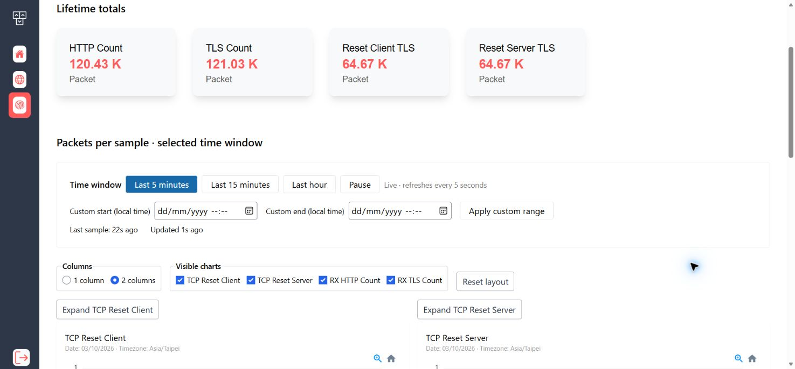

# Frontend chart layout — 3 October 2026

## Layout controls

NPB and Policy Server charts now offer one or two desktop columns, per-chart visibility, inline full-width expand/collapse, and a reset to two columns with every chart visible. Narrow screens use one column through a CSS breakpoint; mobile viewport behavior was not separately browser-tested. The Policy Server Blocked List table and its pagination are unchanged.

Layout preferences are stored in browser local storage under separate versioned NPB and Policy Server keys. They persist across reloads in the same browser; expanded-chart state is transient and resets on reload. Reset affects chart layout only and does not change time-window, live/pause, telemetry, or API behavior. No dependencies, data-processing, or backend/API changes were made.

## Verification

- Automated tests passed: 4 suites, 17 tests.
- Production build exited successfully (`CI=false`); remaining warnings are legacy warnings.
- The update was deployed with a guard against the current page-file hashes, backing up the original pages at `/home/netpro/incoming/frontend-layout-backup.3ZEtbm`. New component files were installed before the page imports. The frontend service is active and `git diff --check` is clean.
- Edge Policy Server UI verification confirmed two-column layout (660 px per column), one-column selection, hiding RX TLS Count, expanding TCP Reset Client with its Collapse control visible, and persistence of one column plus hidden-chart state after reload. Expansion correctly did not persist. Reset restored two columns and all charts. Live telemetry continued updating, and the Blocked List table remained unchanged.
- Edge NPB UI verification confirmed two columns with HTTP, HTTPS, and RX charts visible, a loaded sample with Live refresh continuing at 5-second intervals, inline HTTP expand/collapse while the other charts remained visible, and Reset restoring two columns with all three charts visible and no stale collapse control. The console showed only the legacy Sidebar `clip-path` warning and no exceptions.
- Mobile viewport behavior remains unverified.

The captured [layout test output](../evidence/frontend-2026-10-03/layout-tests.txt) and [production build output](../evidence/frontend-2026-10-03/layout-build.txt) are retained with the screenshots.

The source changes remain local; no upstream push was made.
