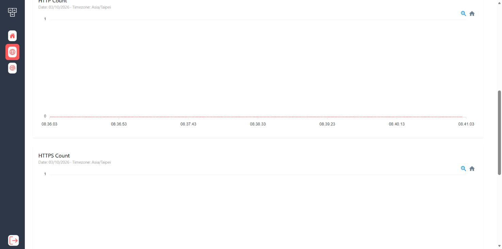
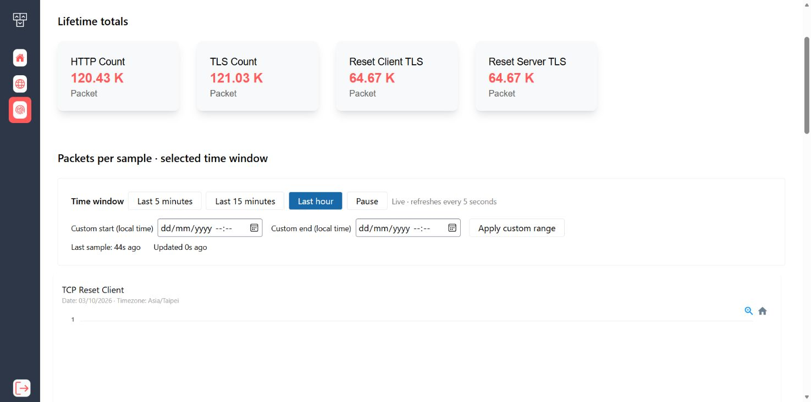

# Frontend time-window update — 3 October 2026

## Changes

The NPB and Policy Server charts now support 5-minute, 15-minute, 1-hour, and custom windows (up to 24 hours), with Live/Pause controls and a 5-second live refresh. The chart uses a continuous timestamp axis with six tick intervals; labels use local time. Counters remain integer packet counts per telemetry sample, not rates. Timeline loading is bounded to 20 pages of 1,000 records, and the UI reports partial history when that cap prevents complete coverage. Sample age, request errors, and empty windows are presented separately; missing samples are not filled with zeroes.

Lifetime totals remain distinct from the selected chart window. The Policy Server blocked-list table and its existing pagination were preserved.

## Verification

- Automated tests passed: 3 suites, 11 tests.
- Production build exited successfully (`CI=false`); the remaining warnings are pre-existing and unrelated to this change.
- The update was deployed to the live frontend after baseline-hash checks. A partial first deployment omitted the hooks directory; the runtime files were compared against the tested staging copies, the directory was created, and the missing tested hook files were copied. The recovery backup is `/home/netpro/incoming/frontend-window-backup.KLVg7S`.
- Edge UI verification on NPB confirmed live API totals and samples, the default 5-minute window, the 15-minute selection, Pause/Live behavior, sparse axis labels, absence of chart pagination, and invalid custom-range feedback. A successful custom-range submission was not verified because browser automation left the date inputs empty.
- Edge UI verification on Policy Server confirmed metadata and lifetime totals, all four charts (TCP Reset Client/Server and RX HTTP/TLS), a loaded sample in the selected one-hour window, and the existing Blocked List table with its pagination intact (1–1 of 1). At the recorded check, the latest sample was 18 seconds old and the dashboard had refreshed one second earlier.
- After deployment, the frontend runtime showed no exceptions; the only observed console warning was the pre-existing Sidebar `clip-path` warning. A successful custom-range submission remains unverified because browser automation left the date inputs empty.
- The source changes remain local; no upstream push was made.

Screenshots and verification logs are curated in the documentation repository:

- NPB dashboard: 
- Policy Server dashboard: 
