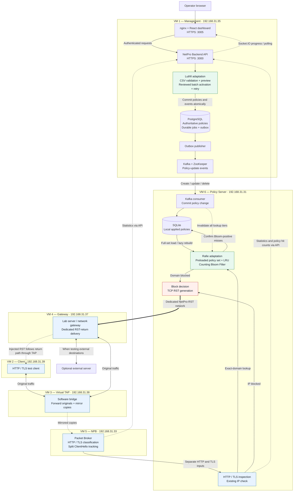
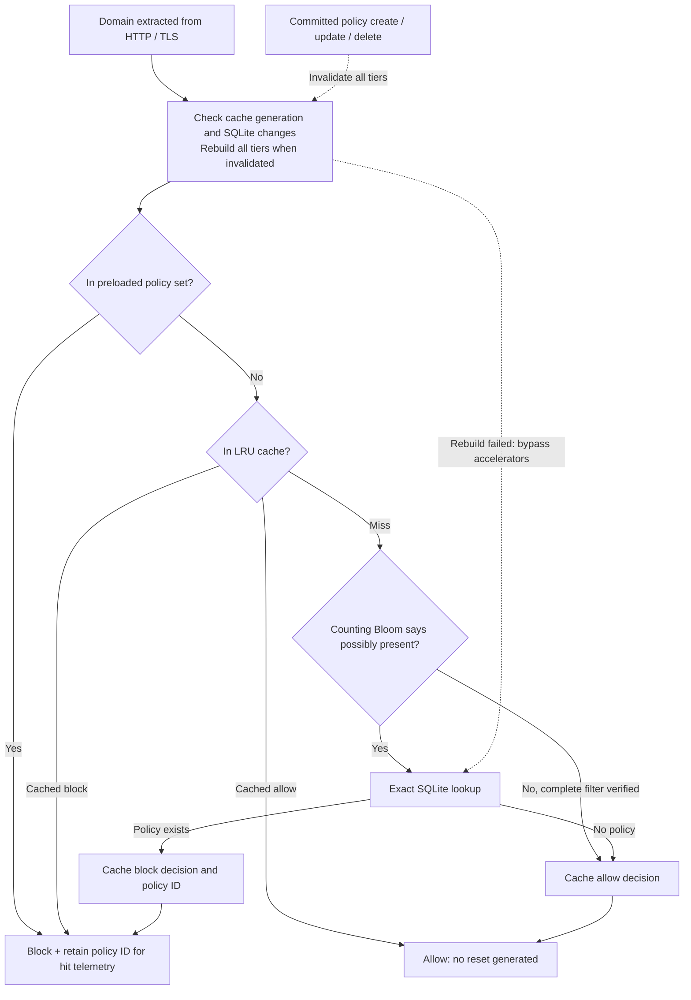

# Current adapted NetPro architecture

31 October 2026. Six running VMs; Luthfi's CSV flow and Rafie's HTTP/TLS lookup adaptation are deployed together. Boxes represent logical services; only the six named VM groups are virtual machines. The operator browser and optional external server are not extra NetPro VMs.

Original traffic follows Client ↔ Virtual TAP ↔ Gateway. NetPro inspects mirrored copies. A block decision generates a new reset packet delivered over the dedicated reset network to the Gateway, then back toward the Client through the TAP. The dotted Gateway-to-Client reset arrow is a logical return path, not an extra direct network adapter.

Green components identify the newly adapted work. CSV validation and approval happen on Management; policy lookup acceleration happens on Policy Server. Kafka carries policy changes. The depicted NPB/Policy Server statistics use the backend API; PostgreSQL stores dashboard data. Import progress reaches the dashboard through authenticated Socket.IO or polling.

## Detailed domain decision path

A Bloom-positive result alone never causes blocking. Cache eviction follows real LRU. Saturated counting cells are not decremented on deletion: the complete filter is rebuilt lazily to avoid false negatives. Policy IDs are preserved on cached block decisions.

## Scope and supporting services

- This is the accepted **HTTP/TLS lab architecture**, including tested split ClientHello handling. Luthfi and Rafie were tested together with 1,001 policy additions/removals.
- Original traffic forwarding uses a **software Virtual TAP**. It does not establish hardware passive-TAP fail-open behavior.
- The dedicated Gateway reset return is the current lab attachment arrangement.
- The experimental original QUIC profile remains separate and is **not** represented as fully adapted or proven by the HTTP/TLS tests above.
- Management also hosts SNMP/Zabbix support from the monitoring work. Those services are outside this policy-import/HTTP-TLS acceptance diagram; no new end-to-end monitoring acceptance is implied here.
- Kafka publication acknowledgement is not an automatic Policy Server enforcement acknowledgement. Live acceptance checked SQLite and actual client behavior separately.
- Existing backend caches, CPU/core assignments, management interfaces and sidecar monitoring connections are omitted for readability. See [Luthfi acceptance](LUTHFI-ACCEPTANCE.md), [Rafie acceptance](RAFIE-ACCEPTANCE.md) and `test-results/` for implementation and validation detail.
